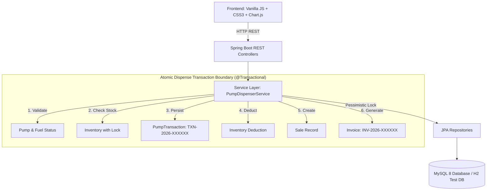

# PETROFLOW - Petrol Station Management & Automation System


PetroFlow is a production-grade, full-stack **Petrol Station Management and Forecourt Automation Platform** built with Java Spring Boot, Spring Data JPA, Hibernate, MySQL 8, and modern Vanilla HTML5/CSS3/JavaScript.

It models the entire lifecycle of a commercial petrol station: fuel catalog pricing, underground tank inventory levels, staff attendance, supplier deliveries, sales ledgers, customer billing/invoicing, and an **Automated Digital Pump Simulator**.

---

## 🚀 Key Highlights & Architectural Principles

1. **Clean Monolithic Architecture**: Simple to run with standard Maven (`mvn spring-boot:run`), zero Node.js build overhead, and high-performance server-side REST APIs.
2. **Business Identifiers (No Leaked DB IDs)**: Database primary keys (`id = 1`) are strictly kept internal. The user interface and REST APIs expose unique, human-readable reference numbers:
   - **Fuel**: `PETROL`, `DIESEL`, `CNG`
   - **Staff**: `EMP-001`, `EMP-002`
   - **Suppliers**: `SUP-001`, `SUP-002`
   - **Pumps**: `PUMP-01`, `PUMP-02`
   - **Transactions**: `TXN-2026-000001`
   - **Invoices**: `INV-2026-000001`
3. **Automated Pump Simulator**: A digital dispenser interface with LED rate/volume meters, live flow animations, and atomic settlement.
4. **Transaction Safety & Concurrency**: Atomic `@Transactional` operations with **Pessimistic Locking** (`SELECT ... FOR UPDATE`) ensuring inventory never dips below zero even when concurrent pumps dispense simultaneously.
5. **Multi-Unit Fuel Support**: Native support for **Litres (`L`)** and **Kilograms (`KG`)** without lossy unit conversions.

---

## 🏛️ System Architecture & Workflow



---

## 📊 Core Modules

| Module | Description |
| :--- | :--- |
| **Operational Dashboard** | Live KPI counters (Today's Sales, Revenue, Litres Dispensed, Active Dispensers), 7-day revenue trend chart, fuel share doughnut chart, low-stock warning banners. |
| **Pump Monitor** | Forecourt dispenser grid with real-time status (`ONLINE`, `OFFLINE`, `MAINTENANCE`, `DISPENSING`), supported fuel, and latest transaction badge. |
| **Pump Simulator** | High-fidelity digital fuel dispenser simulation with LED displays, target quantity input, fuel flow animation, and instant invoice settlement. |
| **Sales Ledger** | Searchable, filterable transaction history with pump, fuel, attendant, volume, price, and total amount. |
| **Billing & Invoices** | Complete tax billing engine with instant modal invoice viewer and print stylesheet. |
| **Fuel Master** | Product catalog managing unit prices (₹/L, ₹/KG) and active availability. |
| **Tank Inventory** | Real-time underground tank stock levels, minimum reserve thresholds, and restock delivery logs. |
| **Employee Directory** | Attendants, station supervisors, and forecourt cashiers with auto-generated `EMP-xxx` codes. |
| **Supplier Network** | Registered oil corporations (BPCL, IOCL, HPCL) with auto-generated `SUP-xxx` codes. |
| **Analytics & Reports** | Multi-dimensional financial reports with custom date ranges, fuel-type filters, and employee performance breakdown. |

---

## 🔌 REST API Endpoints

### Dashboard & Analytics
- `GET /api/dashboard` - Fetches aggregated today KPIs, chart time series, inventory status, and recent sales.
- `GET /api/reports/sales?startDate=...&endDate=...&fuelCode=...&pumpCode=...&employeeCode=...` - Generates filtered financial and volume reports.

### Pump Simulator & Forecourt Operations
- `POST /api/pump-transactions/dispense` - Atomically dispenses fuel, checks stock, deducts inventory, creates `PumpTransaction`, `Sale`, and `Invoice`.
- `GET /api/pump-transactions` - Returns list of all dispenser transactions.
- `GET /api/pumps` - Lists all forecourt dispensers.
- `POST /api/pumps` - Registers a new pump dispenser.
- `PUT /api/pumps/{pumpCode}/status?status=ONLINE` - Updates pump operational state.

### Sales & Invoices
- `GET /api/sales` - Fetches sales records.
- `GET /api/sales/{transactionNumber}` - Fetches sale details by TXN number.
- `GET /api/invoices` - Lists all invoices.
- `GET /api/invoices/{invoiceNumber}` - Retrieves invoice by INV number.
- `GET /api/invoices/transaction/{transactionNumber}` - Retrieves invoice by associated TXN number.

### Fuels & Inventory
- `GET /api/fuels` - Returns fuel products catalog.
- `POST /api/fuels` - Adds a new fuel product.
- `PUT /api/fuels/{fuelCode}` - Updates fuel price and active status.
- `GET /api/inventory` - Lists current stock and threshold status for all fuel tanks.
- `POST /api/inventory/adjust` - Restocks or calibrates tank inventory (`ADD` or `SET`).
- `PUT /api/inventory/{fuelCode}/minimum-level?minimumLevel=150` - Updates low stock alert threshold.

### Staff & Suppliers
- `GET /api/employees` - Lists staff directory.
- `POST /api/employees` - Registers employee (auto-generates `EMP-xxx`).
- `GET /api/suppliers` - Lists oil suppliers and depots.
- `POST /api/suppliers` - Registers supplier (auto-generates `SUP-xxx`).

---

## ⚙️ Installation & Running

### Prerequisites
- **Java Development Kit (JDK)**: Java 21 or Java 23 installed
- **Apache Maven**: 3.9+ installed
- **MySQL 8.0**: Running locally on port `3306` (or use the built-in in-memory fallback for testing)

### 1. Database Setup
Ensure MySQL is running. The application is configured to automatically create the database `petroflow_db` on startup:
```properties
# src/main/resources/application.properties
spring.datasource.url=jdbc:mysql://localhost:3306/petroflow_db?createDatabaseIfNotExist=true&useSSL=false&allowPublicKeyRetrieval=true&serverTimezone=UTC
spring.datasource.username=root
spring.datasource.password=
spring.jpa.hibernate.ddl-auto=update
```
*(You can also copy `application.properties.example` and supply your custom credentials or set environment variables).*

### 2. Run Automated Test Suite
```bash
cd petroflow
mvn clean test
```
All 9 unit and integration tests run against an isolated in-memory H2 database.

### 3. Start Application
```bash
mvn spring-boot:run
```
Once started, access the application in your browser:
**`http://localhost:8080`**

---

## ⛽ Step-by-Step Demonstration Flow (Pump Simulator)

1. Open **`http://localhost:8080`** in your browser.
2. Note initial master state:
   - **Petrol Tank**: 1000 L available (Threshold: 150 L, Price: ₹108.50/L)
   - **PUMP-01**: ONLINE, dispensing Petrol
   - **Today's Sales**: 0 | **Today's Revenue**: ₹0.00
3. Navigate to **Pump Simulator** in the sidebar.
4. Select **PUMP-01 (Petrol)**.
5. Enter Quantity: **`20.00`** L.
6. The system automatically calculates:
   $$\text{Total Amount} = 20.00 \times 108.50 = \text{₹}2170.00$$
7. Click **`START`**:
   - Status changes to **`DISPENSING`**.
   - Nozzle status shows fuel flowing.
   - LED volume meter increments smoothly towards 20.00 L.
8. Click **`COMPLETE TRANSACTION`**:
   - The backend executes the atomic transaction:
     1. Validates stock and pump online status.
     2. Creates `PumpTransaction` `TXN-2026-000001`.
     3. Deducts 20 L from inventory ($1000 \to 980$ L).
     4. Creates `Sale` record.
     5. Generates official Invoice `INV-2026-000001`.
   - An **Official Invoice Viewer modal** pops up automatically with printable receipt formatting.
9. Return to the **Dashboard**:
   - Today's Sales increments: **`+1`**
   - Today's Revenue increments: **`+₹2,170.00`**
   - Today's Fuel Dispensed increments: **`+20.0 L`**
   - Recent Sales table shows `TXN-2026-000001`.
10. Check **Tanks & Inventory**:
   - Petrol stock is accurately reflected as **`980 L`**.

---

## 🛡️ Real-World Forecourt Hardware Disclaimer

> **Forecourt Integration Disclaimer:**  
> The Pump Simulator in PetroFlow represents a software simulation of a commercial digital fuel dispenser. It demonstrates the application-side transactional workflow, forecourt state machine, inventory deductions, and billing settlement. Real physical dispenser integration in a live petrol station forecourt would require manufacturer-specific forecourt controllers (e.g., Gilbarco Veeder-Root, Wayne Dresser, Tokheim, DOMS), hardware serial/RS-485 or IFSF/IP communication protocol gateways, emergency shutdown loop interfaces, and appropriate legal metrology / explosive atmosphere safety certifications (ATEX/IECEx).

---

## 🔮 Future Extensions

- Integration with standard Forecourt Controller gateways (IFSF/IP, DOMS PSS 5000).
- IoT ATG (Automatic Tank Gauge) Magnetostrictive Probe telemetry for real-time tank dipping and water detection.
- EMV / Petro-Card payment terminal integration with automated dispenser pre-authorization.
- Automated SMS / WhatsApp e-receipt dispatch via Twilio / Gupshup.
- Cloud multi-station forecourt central fleet & franchise management.
- Dynamic nozzle price signboards (LED totem pole) integration.

---

## 🎓 Placement & Interview Deep-Dive Q&A

### 1. How does a pump transaction work?
A pump transaction follows a state machine:
`READY` $\to$ `DISPENSING` $\to$ `SETTLEMENT` $\to$ `COMPLETED`.  
The operator or customer chooses the dispenser, the system loads current fuel prices and validates tank levels. When dispensing finishes, the client sends a `POST /api/pump-transactions/dispense` request to the backend. The backend executes an atomic business transaction validating stock, creating the pump transaction, deducting inventory, registering the sale, and generating the invoice.

### 2. How is inventory updated?
Inventory is maintained on a per-fuel basis in the `inventories` table. During a dispense operation, the `InventoryService` acquires a lock on the fuel's inventory record, subtracts the dispensed quantity from `currentQuantity`, and persists the updated timestamp. If the updated stock falls below `minimumStockLevel`, the system flags it as `lowStock`.

### 3. How is negative inventory prevented?
Negative inventory is prevented through a multi-layered guard:
1. **Application-level validation**: Verifies $Q_{\text{requested}} \le Q_{\text{available}}$ before initiating settlement.
2. **Pessimistic Write Locking (`LockModeType.PESSIMISTIC_WRITE`)**: Locks the inventory row during execution so concurrent transactions cannot read outdated stock.
3. **Database Constraint / Jakarta Validation**: `@DecimalMin("0.00")` rejects any negative quantity persistence.

### 4. Why use `@Transactional`?
Dispensing fuel involves 4 database writes (`PumpTransaction`, `Inventory` deduction, `Sale`, `Invoice`). If any step fails (such as invoice persistence failure or constraint violation), `@Transactional` ensures that **all changes are rolled back** so the database is never left in an inconsistent state.

### 5. Why use JPA & Hibernate?
JPA provides an object-relational mapping standard that abstracts boilerplate SQL queries, manages entity relationships (`@OneToOne`, `@ManyToOne`), provides automatic dirty checking, and handles transactions and concurrency locking portably across MySQL, PostgreSQL, and H2.

### 6. Why use DTOs (Data Transfer Objects)?
1. Prevents exposing database entity structures and primary keys.
2. Eliminates circular reference issues during Jackson JSON serialization.
3. Allows precise validation rules (`@NotBlank`, `@DecimalMin`) tailored specifically to user input requests.

### 7. Why don't you expose database IDs?
Database numeric primary keys (`1, 2, 3`) are internal database implementation details that can reveal business volume or create security vulnerabilities (e.g., ID enumeration attacks). Exposing structured business identifiers (`PETROL`, `EMP-001`, `PUMP-01`, `TXN-2026-000001`, `INV-2026-000001`) provides clean audit trails and professional domain representation.

### 8. How are transaction numbers generated?
The `IdentifierGeneratorService` formats unique numbers sequentially:
`String.format("TXN-%d-%06d", currentYear, count)`. It verifies uniqueness against the repository to prevent collisions.

### 9. How does the Pump Simulator communicate with the backend?
The simulator uses standard `fetch()` asynchronous REST calls to `POST /api/pump-transactions/dispense` sending the dispenser code, fuel code, attendant code, quantity, and customer info as JSON, receiving the completed `InvoiceDto` response in return.

### 10. How would you connect this to a real petrol pump?
In a production deployment, pumps connect through Forecourt Controllers (like DOMS PSS 5000 or Gilbarco Veeder-Root). We would implement an event-driven adapter layer (using MQTT, WebSockets, or IFSF-over-IP protocols) that listens to dispenser nozzle-lift, pulse metering, and nozzle-holster hardware events and routes them into `PumpDispenserService`.

### 11. How would you handle two pumps dispensing fuel simultaneously?
When two pumps dispense the same fuel (e.g., Petrol from PUMP-01 and PUMP-03), concurrent transactions execute `findByFuelWithLock()`. The database serializes the stock deduction on that specific fuel row. The second transaction waits for the first transaction's lock release, reads the freshly updated stock balance, and ensures the sum of both dispenses does not exceed available tank volume.

### 12. How would you scale this system?
1. **Stateless Service Architecture**: Deploy containerized Spring Boot instances behind an Nginx/ALB load balancer.
2. **Read/Write DB Splitting**: Direct analytics and report queries (`/api/reports`, `/api/sales`) to MySQL Read Replicas while directing dispense operations to the Primary DB.
3. **Redis Caching**: Cache fuel master prices and staff profiles with automatic invalidation on update.
4. **Message Queues**: Decouple non-critical operations (such as SMS receipt sending or external accounting sync) via RabbitMQ / Kafka.

---

## 💼 Resume Description

> **PetroFlow — Petrol Station Management & Automation System (Java, Spring Boot, MySQL, REST, Vanilla JS)**  
> Developed a full-stack petrol station management platform managing fuel catalog pricing, underground tank inventory, staff attendance, supplier networks, sales ledgers, and billing. Engineered a software-based digital pump dispenser simulator with real-time metering and animations, processing forecourt transactions through atomic REST APIs (`@Transactional` with pessimistic locking) that automatically update sales records, deduct inventory, generate invoices, and trigger low-stock alerts. Built responsive modern SPA dashboard with Chart.js analytics and printable tax invoices.

---

## 📝 License
Developed for academic, learning, and enterprise portfolio demonstration purposes. Open source under MIT License.
